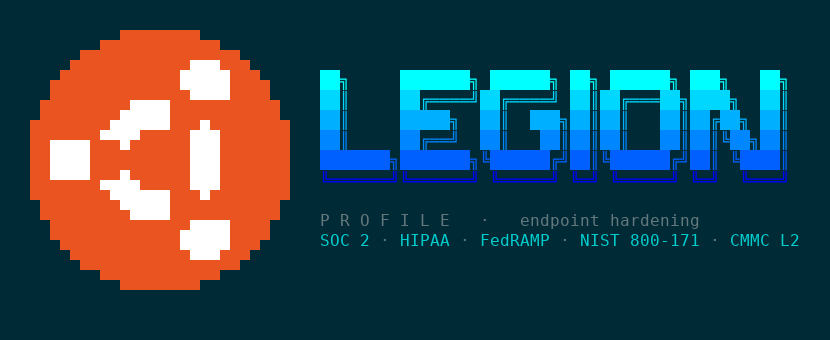

# Legion Profile



Legion hardens Ubuntu 26.04 laptops and desktops and reports on them. Each check maps to SOC 2, HIPAA, NIST 800-53 (FedRAMP) and NIST 800-171 (CMMC Level 2) controls. Every run writes a report and an evidence bundle with checksums for auditors.
## Development Stage:
- Testing

CIS and DISA STIG have not published benchmarks for Ubuntu 26.04 yet. Until they do, Legion uses the CIS Ubuntu 24.04 rules that apply to 26.04. When the official benchmark comes out, Legion runs it automatically.

## What it covers

- Ubuntu Pro: security updates for every package (ESM) and Livepatch. Optional. Needs your free token from https://ubuntu.com/pro/dashboard
- Updates: installs all pending updates and turns on daily automatic security updates
- Firewall: blocks incoming connections, allows outgoing
- Account lockout: 5 failed logins lock an account for 30 minutes, then it unlocks by itself
- Login banner, and a screen lock after 10 minutes that users cannot turn off. The login screen asks for the user name instead of listing users
- Passwords: 12+ characters and 3 character types, the last 24 cannot be reused, and they expire every 90 days. An account is disabled 45 days after its password expires
- Sessions: idle console and SSH sessions end after 15 minutes, new files are private to their owner (umask 027), sudo asks for the password again after 15 minutes, and only root can use su
- Audit logging: the CIS set of audit rules. Changes to accounts, sudo and settings, logins, refused file access, permission changes, deletions, mounts, kernel modules and every use of a privileged program. You get an alert when the audit log disk runs low
- Log retention: keeps system logs for 1 year
- Malware scanning: ClamAV weekly, plus YARA weekly with the YARA Forge core rules
- Vulnerability scanning: weekly, with Ubuntu's own security notices (OVAL) and OpenSCAP
- File integrity: daily check of installed package files and of /etc, /boot, /usr/local and /root
- System hardening: safer kernel settings, unused network protocols and filesystems blocked, no core dumps, USB drives and discs never start programs, SSH server hardened (if installed), tighter cron, sudoers and account file permissions
- File and account review (report only): world-writable files, files without an owner, setuid programs that no package installed, duplicate IDs, open home folders, system accounts with a login shell
- Daily compliance check: flags any check that starts failing

## Before you run it

**Encrypt the disk when you install Ubuntu.** Encryption can only be turned on during installation (Advanced features, then Use LVM and encryption). It cannot be added later without wiping the disk.

## How to run it

```bash
git clone https://github.com/OpenSource-For-Freedom/legion-profile.git
cd legion-profile
bash legion.sh
```

It asks for your sudo password, then a few questions so the firewall does not cut you off: whether to keep SSH or Remote Desktop reachable (if they are running), whether you use Tailscale, which private networks need to reach this device, and whether you need IPv6. It also asks for your Ubuntu Pro token (press Enter to skip). Then it runs each step and shows the result. Reboot when it finishes.

To skip the token question:

```bash
UBUNTU_PRO_SECRET=your-token bash legion.sh
```

After the first run, check the device any time without changing anything:

```bash
sudo legion --check
```

Run `bash legion.sh --help` for all options. It is safe to run again.

## Reports and evidence

- Compliance report: `/var/log/legion/compliance-report.md` (and `.json`)
- Evidence bundles: `/var/log/legion/evidence/`, each with a SHA-256 checksum
- Scan results: `/var/log/legion/yara-scan.log` and `integrity.log`

A ClamAV, YARA, integrity or daily compliance finding marks its service as failed. Check with `systemctl --failed`.

Package updates are accepted into the integrity baseline automatically. Any other change to watched files stays reported in `/var/log/legion/integrity.log` until you review it and accept it with `sudo legion-aide-baseline manual`.

## If you get locked out

Wait 30 minutes, or have another admin run `sudo faillock --user NAME --reset`.

## Testing

Every change is tested in an Ubuntu 26.04 container with systemd:

```bash
bash tests/run.sh
```

It installs Legion, checks the firewall, lockout, passwords, sessions, integrity and scan results, runs Legion again, removes it and confirms the system is back to how it was.

Containers cannot load audit rules or kernel settings, so a second test runs Legion in a real Ubuntu 26.04 virtual machine (QEMU, inside Docker), reboots it, checks again and removes Legion:

```bash
bash tests/vm/run.sh
```

It needs Docker and hardware virtualization (/dev/kvm), and downloads the Ubuntu cloud image once.

## How to remove it

If something breaks, this undoes Legion's settings and puts Ubuntu's defaults back:

```bash
bash legion-remove.sh
```

It keeps installed updates, Ubuntu Pro and your logs. Add `--remove-packages`, `--detach-pro` or `--purge-logs` to remove those too. Reboot afterward.

## Notes

- No script makes an organization compliant. These frameworks also cover policies, training, backups and vendor agreements. The report lists what Legion cannot check.
- FIPS-validated cryptography, required for FedRAMP and CMMC, is not yet available for Ubuntu 26.04. Legion reports it and picks it up once Ubuntu Pro offers it.
- Docker bypasses the firewall for published container ports.
- Passwords expire every 90 days. On the first run, a password that is already older than 76 days gets 14 more days, so nobody is forced to change it in the middle of a session.
- Files you create are no longer readable by other users. Commands run with sudo keep Ubuntu's usual permissions, so software installed with sudo still works for everyone.
- Some filesystems are blocked: hfs and hfsplus (Mac drives), udf (DVDs and some USB drives), cramfs, freevxfs and jffs2. USB drives formatted as FAT, exFAT or NTFS work as usual.
- sudo-rs, Ubuntu 26.04's sudo, has no separate log file. sudo use is recorded in the system journal and by the audit rules.
- Earlier versions of Legion installed the Postfix mail server as a side effect of installing AIDE. Legion now sets Postfix to accept connections from this device only. If nothing on your machine sends mail, you can remove it: `sudo apt purge postfix bsd-mailx`.
