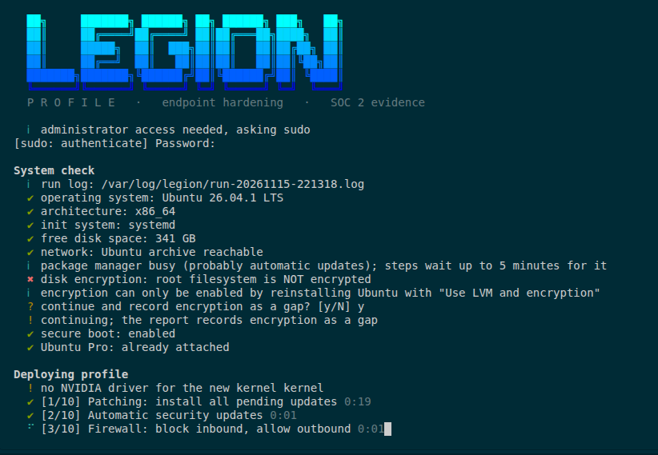

# Legion Profile

A single script that hardens an Ubuntu laptop or desktop and writes an evidence report you can hand to a SOC 2 auditor. It goes past SOC 2 with YARA malware scanning and file integrity monitoring.



## What it covers

- **Ubuntu Pro**: security updates for every package (ESM) and Livepatch. Optional, needs your free token from https://ubuntu.com/pro/dashboard
- **Updates**: installs all pending updates and turns on daily automatic security updates
- **Firewall**: blocks incoming connections, allows outgoing
- **Audit logging**: records changes to accounts, sudo, system time, kernel modules and the firewall
- **Log retention**: keeps system logs for 1 year
- **Malware scanning**: ClamAV weekly, plus YARA weekly with the YARA Forge core rules
- **File integrity**: daily check of installed package files and of /etc, /boot, /usr/local and /root
- **Password policy**: new passwords need 12+ characters and 3 character types
- **System hardening**: safer kernel settings, unused network protocols blocked, tighter cron and sudoers permissions
- **Evidence report**: `/var/log/legion/endpoint-report.txt`

It does not set up disk encryption, backups, device management (MDM) or central logging. SOC 2 also covers policies and processes that no script can.

## Before you run it

**Encrypt the disk when you install Ubuntu.** Encryption can only be turned on during installation (Advanced features, then Use LVM and encryption). It cannot be added later without wiping the disk.

## How to run it

Works on Ubuntu 24.04 and 26.04.

```bash
git clone https://github.com/OpenSource-For-Freedom/legion-profile.git
cd legion-profile
bash legion.sh
```

It asks for your sudo password and your Ubuntu Pro token (press Enter to skip), then runs each step and shows the result. Reboot when it finishes.

To skip the token question:

```bash
UBUNTU_PRO_SECRET=your-token bash legion.sh
```

Run `bash legion.sh --help` for all options. It is safe to run again.

## How to remove it

If something breaks, this undoes Legion's settings and puts Ubuntu's defaults back:

```bash
bash legion-remove.sh
```

It keeps installed updates, Ubuntu Pro and your logs. Add `--remove-packages`, `--detach-pro` or `--purge-logs` to remove those too. Reboot afterwards.
